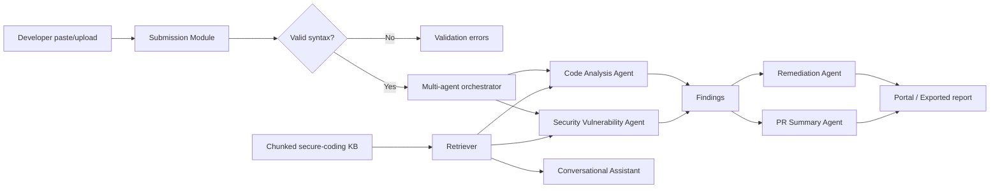

# System Architecture and Data Models

## Components

- **Submission API/CLI**: receives pasted text or a `.py`/`.java` file, applies size and encoding limits, and validates without executing code.
- **Orchestrator**: later milestone entry point that will fan a valid `SubmissionResult` out to specialist agents.
- **Knowledge Base**: Markdown secure-coding sources → chunker → embedding provider → persistent vector store → retriever.
- **Agents**: Code Analysis, Security Vulnerability, Remediation, PR Summary, and Conversational Code Assistant. Their contracts are defined now so later milestones can plug them in.
- **Report/UI layer**: consumes structured findings and exports a review report.

## Orchestration flow

1. Submit paste/file.
2. Identify language and validate syntax/structure.
3. If invalid, return line-aware validation issues and stop before analysis.
4. If valid, create an analysis job and dispatch it to code-quality and security agents.
5. Agents retrieve relevant secure-coding chunks by query.
6. Remediation and PR Summary agents consume findings and produce actionable outputs.
7. UI/report exporter presents severity breakdown, evidence, and remediation roadmap.

## Core data contracts

`SubmissionResult`: `submission_id`, `language`, `source_name`, `source_length`, `valid`, and line-aware `ValidationIssue[]`.

`KnowledgeChunk`: stable `chunk_id`, source, title, chunk text, sparse embedding terms, and word-range metadata.

Future `Finding`: `finding_id`, agent, rule/CWE/OWASP reference, severity, confidence, file, line range, evidence, explanation, remediation, and related knowledge chunk IDs.

## Responsibility boundaries

Agents should not execute submitted code. The orchestrator owns lifecycle and correlation IDs; analyzers own detection; the knowledge base owns grounding; remediation owns fix examples; summary owns presentation. This separation makes each later milestone testable and replaceable.
